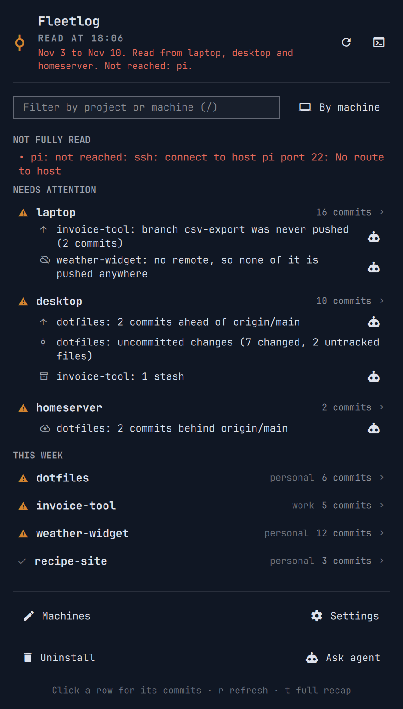

<h1 align="center">fleetlog</h1>

<p align="center"><code>git log</code> for all your machines: your commits from every repo on every machine, grouped by project, and where you left each one. A command for any Linux terminal, and on Omarchy a panel in the bar.</p>

<p align="center">Part of <a href="https://github.com/Frestina/fleet">Fleet</a>: fleetwatch · fleetlog · fleetdrop</p>

<p align="center"><a href="https://github.com/tcballard/omarchy-badges"></a></p>

<p align="center"></p>

After a few days away from a project it is hard to remember where it
stopped: which machine has the newest commits, what was never pushed, and
what you finished that week at all. fleetlog reads every machine you list
and ends each project with where you left it: commits not pushed, branches
never pushed, uncommitted changes and stashes, and commits one machine has
that another never fetched. That is the part a GitHub activity page can't
show.

```
fleetlog              # the last 7 days
fleetlog --since 2w   # or a date: --since 2026-10-01
fleetlog status       # only where each project was left
fleetlog --json       # exact data, for scripts and agents
```

`git fleetlog` works too: `install.sh` also links the command as
`git-fleetlog`, which git runs as one of its own.

It reads machines over ssh, one call per machine, and changes nothing: no
fetch, no pull, no push. The other machines need only bash and git, and no
Omarchy. It doesn't need
[Fleetwatch](https://github.com/Frestina/fleetwatch) either, and
shares one list of machines with it and the other
[Fleet](https://github.com/Frestina/fleet) tools.

On Omarchy, the bar icon counts the projects that need attention:

- **Left-click:** a panel with your week, sorted by what needs doing: what
  is left off first, by machine or by project (a button, or `g`, switches),
  then the week's projects. Each line has an icon for what it takes: a push,
  a fetch, a commit. Type `/` and a project's or a machine's name to see only
  that. Click a row for its commits, or the agent button next to what is left
  off to [work on it with your coding agent](#ask-your-agent).
- **Right-click:** the full recap in a terminal.

The bottom of the panel opens your list of machines and the settings in your
editor, can hand the setup to your coding agent, and uninstalls fleetlog.

## What it shows

```markdown
# Recap, Oct 16 to Oct 23

Read from laptop, desktop and homeserver. Not reached: pi.

## weather-widget (personal), 12 commits

- Oct 22 laptop: Show tomorrow's frost warning
- Oct 22 laptop: Cache the forecast for an hour
- ...

Left off:
- laptop: no remote, so none of it is pushed anywhere

## Also left off

### dotfiles (personal)

Left off:
- desktop: 6 commits ahead of origin/main
- desktop: uncommitted changes (9 changed files)
- homeserver: 2 commits behind origin/main

## Not reached

- pi: ssh: connect to host pi port 22: No route to host
```

Projects are sorted by their newest commit, and the same repo on several
machines is one project. A machine that couldn't be read is always listed, so
a short recap never just means missing data.

A clone that never fetched looks up to date to itself. fleetlog still
fetches nothing: it compares what your machines already have, so the last
line above comes from another machine having fetched what homeserver has
not. `--json` says which one, and as of when.

## Requirements

- Python 3.11 or newer on the machine you run it from.
- On the machines it reads: any Linux with `bash` and `git`, reachable with
  `ssh <target>` using a key, without any password prompt or agent. A machine
  that asks shows as not reached.
- For the panel: Omarchy 4.

## Install

On Omarchy, as a plugin, with the panel:

```
omarchy plugin add https://github.com/Frestina/fleetlog --enable
```

The `fleetlog` command comes with it, but isn't on your `PATH` until you
link it (**Set up with agent** offers to do this):

```
~/.config/omarchy/plugins/io.github.frestina.fleetlog/install.sh
```

Anywhere else, the command alone:

```
git clone https://github.com/Frestina/fleetlog
fleetlog/install.sh       # links fleetlog and git-fleetlog into ~/.local/bin
```

To open the panel from the keyboard too, add to
`~/.config/hypr/bindings.lua`:

```lua
o.bind("SUPER + CTRL + G", "Fleetlog", "omarchy-shell shell toggle io.github.frestina.fleetlog")
```

## Machines

**Machines** at the bottom of the panel, or:

```
fleetlog machines     # opens the list in your editor
```

The list is `~/.config/fleet/hosts`, which every
[Fleet](https://github.com/Frestina/fleet) tool reads, so you list your
machines once. If you use one already, fleetlog reads the list that is
there; otherwise it is written with this machine in it the first time you
open it.

One machine a line, `<label> <ssh target> [<hostname>]`, where the target is
whatever you would type after `ssh`. The line whose hostname is this
machine's is read here, without ssh, so the same list works on every machine.
The panel reads every machine again when you save. The full format is in
[HOSTS.md](https://github.com/Frestina/fleet/blob/main/HOSTS.md).

To read a machine that is not in the list, or leave one out, see `[machines]`
under [Settings](#settings).

Your commits are the ones whose author email is in your global git config:
`user.email` and every `[identity "<name>"] email`.

### Or let your agent do it

**Set up with agent** at the bottom of the panel starts your default coding
agent (`omarchy agent`; pick one in the Omarchy menu if you haven't) with
[a setup guide](docs/AGENT_SETUP.md). It finds your machines in your ssh
config, tests them with your permission and fills in the list with you. Once
you have listed other machines it becomes **Ask agent**, to go through your
config, machines and timers, or ask about what the panel shows.

## Ask your agent

Each project that needs attention has an agent button for each machine with
something left off. It opens a terminal with your agent already in that
repo, told what is left off, so you can sort it out together: here, or on the
other machine over `ssh -t`, with that machine's own default agent (or a
shell, when it has none). Omarchy starts agents with approvals switched off,
so [their guide](docs/AGENT_REPO.md) has them look freely but ask before
committing, pushing or deleting anything.

## Weekly recap

On a machine that is always on:

```
fleetlog timers install main
```

It builds the recap of the 7 days before, Fridays at 15:15 unless the
config says otherwise, at the lowest priority, and tries machines it could
not reach again every hour for two more days. On the machines you sit at,
with `machine = "<its label>"` under `[main]` in the config:

```
fleetlog timers install viewer
fleetlog latest       # the last weekly recap, any time
```

They show a notification once the week's recap is ready. It stays until you
click it away, and clicking it opens the recap in a terminal.

`[recap]` in the config changes all of that: another day and time, or `"off"`;
only some machines to show it; a notification that goes away by itself. A
changed time is written into the timers when they are installed, so run
`fleetlog timers install` again on the machines that have them. Until you
do, the panel and `fleetlog timers status` say so. Set it the same on every
machine: a machine that shows the recap follows the main machine's time,
but says so, and may show it late, while its own differs.

```toml
[recap]
when = "Mon 08:30"                  # or "off"; not on the hour or at :02, :07...
notify = ["laptop"]                 # or "all", the default
stays = false                       # true, the default: until it is clicked
```

Fleet doctor reads the machines on the hour and every 5 minutes from :02,
and fleetlog keeps off those minutes, so the config refuses a time on one
of them and names the nearest free ones.

## Settings

**Settings** at the bottom of the panel, or `fleetlog config`, opens
`~/.config/fleet/log/config.toml`, with every setting commented out the first
time. Remove the `#` in front of one to turn it on. It is TOML: text in
double quotes, lists in brackets.

```toml
[main]
machine = "homeserver"              # builds the weekly recap

[recap]
when = "Fri 15:15"                  # when it is built, or "off"
notify = "all"                      # the machines that show it
stays = true                        # the notification stays until clicked

[folders]
all = ["~/Projects", "~/dotfiles"]  # where repos are looked for, 4 levels deep
homeserver = ["~/srv"]              # more on one machine, said if not there

[machines]
nas = "nas"                         # a machine only fleetlog reads
skip = ["pi"]                       # one in the list it leaves out

[exclude]
projects = ["scratch"]              # by the name the recap shows
repos = ["~/Projects/scratch"]      # that repo, and every repo under it

[identity]
emails = ["old-address@example.org"]  # more commits that are yours

[panel]
group = "machine"                   # or "project": what the panel groups by
```

## What it runs and stores

- The panel runs the plugin's own `bin/fleetlog` once an hour, at :20,
  and when you refresh. Opening the panel shows that read and asks no
  machine anything.
- That runs a read-only bash script on each machine: locally, and on the
  others over one `ssh -T -o BatchMode=yes -o ForwardAgent=no -o
  IdentityAgent=none` call, at the lowest priority. It reads what is on disk
  and changes nothing.
- The last read is kept in `~/.cache/fleet/log/`, and the weekly recap in
  `~/.local/state/fleet/log/`.
- Your settings are in `~/.config/fleet/log/`, and the list of machines in
  `~/.config/fleet/hosts`. Each is only ever written when you open it for the
  first time.
- **Set up with agent**, **Ask agent** and the agent buttons run
  `omarchy agent` with your default coding agent, which sends what it reads
  to that agent's provider like any other session.

## Update

```
omarchy plugin update io.github.frestina.fleetlog
omarchy restart shell
```

The restart makes the shell load the new panel; the command updates without
it. For a clone, `git pull` in it.

## Remove

Choose **Uninstall** at the bottom of the panel, or run:

```
fleetlog uninstall
```

It lists what fleetlog added on this machine (its timers, its
`fleet/log` folders in `~/.config`, `~/.cache` and `~/.local/state`, and the
`~/.local/bin` links) and asks whether to remove the plugin and all of that, or
only the plugin. The list of machines, `~/.config/fleet/hosts`, goes too only
when no other Fleet tool's folder is left beside it. A folder or file that is
a link, into your dotfiles say, loses only the link. A keybinding you added
is pointed out for you to remove.

## Development

```
./tests/run
```

The tests need no ssh and no second machine. To work on the panel, link your
checkout instead of adding the plugin:

```
ln -s "$PWD" ~/.config/omarchy/plugins/io.github.frestina.fleetlog
omarchy plugin enable io.github.frestina.fleetlog
```

The shell does not reload a linked plugin by itself: run `omarchy restart
shell` after a change to `panel/`. [SPEC.md](SPEC.md) has every decision
behind it.

`demo/run` retakes `preview.png` from the running panel, with the fictional
fleet in `demo/fixtures/read.json` instead of yours, and puts your own back
afterwards.

## Licence

[MIT](LICENSE).
