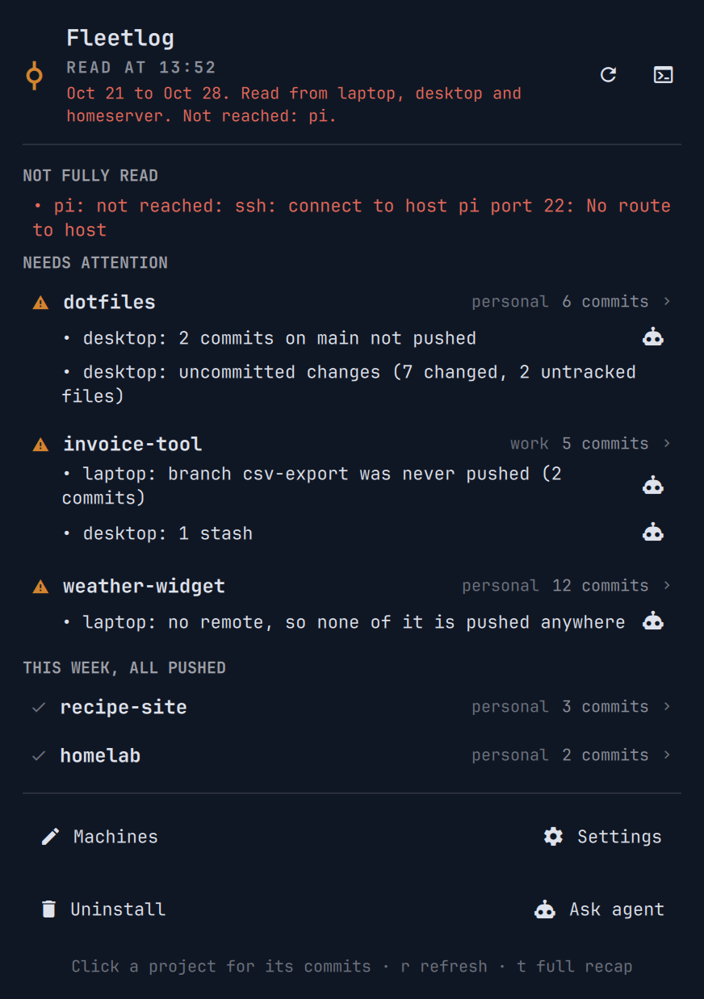

<h1 align="center">git-fleetlog</h1>

<p align="center"><code>git log</code> for all your machines: your commits from every repo on every machine, grouped by project, and where you left each one. A command for any Linux terminal, and on Omarchy a panel in the bar.</p>

<p align="center"><a href="https://github.com/tcballard/omarchy-badges"></a></p>

<p align="center"></p>

After a few days away from a project it is hard to remember where it
stopped: which machine has the newest commits, what was never pushed, and
what you finished that week at all. git-fleetlog reads every machine you list
and ends each project with where you left it: commits not pushed, branches
never pushed, uncommitted changes and stashes. That is the part a GitHub
activity page can't show.

```
git fleetlog              # the last 7 days
git fleetlog --since 2w   # or a date: --since 2026-10-01
git fleetlog status       # only where each project was left
git fleetlog --json       # exact data, for scripts and agents
```

It reads machines over ssh, one call per machine, and changes nothing: no
fetch, no pull, no push. The other machines need only bash and git, and no
Omarchy. It doesn't need
[Fleetwatch](https://github.com/Frestina/omarchy-fleetwatch) either, and
shares its list of machines when you have it.

On Omarchy, the bar icon counts the projects that need attention:

- **Left-click:** a panel with your week, sorted by what needs doing:
  projects with work left off first, then the ones all pushed. Click a
  project for its commits, or the agent button next to what is left off to
  [work on it with your coding agent](#ask-your-agent).
- **Right-click:** the full recap in a terminal.

The bottom of the panel opens your list of machines and the settings in your
editor, can hand the setup to your coding agent, and uninstalls git-fleetlog.

## What it shows

```markdown
# Recap, Oct 16 to Oct 23

Read from laptop, desktop and homeserver. Not reached: pi.

## weather-widget (personal), 12 commits

- Oct 22 laptop: Show tomorrow's frost warning
- Oct 22 laptop: Cache the forecast for an hour
- ...

Left off:
- laptop: no remote, so none of it is pushed anywhere

## Also left off

### dotfiles (personal)

Left off:
- desktop: 6 commits on main not pushed
- desktop: uncommitted changes (9 changed files)

## Not reached

- pi: ssh: connect to host pi port 22: No route to host
```

Projects are sorted by their newest commit, and the same repo on several
machines is one project. A machine that couldn't be read is always listed, so
a short recap never just means missing data.

## Requirements

- Python 3.11 or newer on the machine you run it from.
- On the machines it reads: any Linux with `bash` and `git`, reachable with
  `ssh <target>` using a key, without any password prompt or agent. A machine
  that asks shows as not reached.
- For the panel: Omarchy 4.

## Install

On Omarchy, as a plugin, with the panel:

```
omarchy plugin add https://github.com/Frestina/git-fleetlog --enable
```

The `git fleetlog` command comes with it, but isn't on your `PATH` until you
link it (**Set up with agent** offers to do this):

```
~/.config/omarchy/plugins/io.github.frestina.fleetlog/install.sh
```

Anywhere else, the command alone:

```
git clone https://github.com/Frestina/git-fleetlog
git-fleetlog/install.sh   # links git-fleetlog into ~/.local/bin
```

To open the panel from the keyboard too, add to
`~/.config/hypr/bindings.lua`:

```lua
o.bind("SUPER + CTRL + G", "Fleetlog", "omarchy-shell shell toggle io.github.frestina.fleetlog")
```

## Machines

**Machines** at the bottom of the panel, or:

```
git fleetlog machines     # opens the list in your editor
```

One machine a line, `<label> <ssh target> [<hostname>]`, where the target is
whatever you would type after `ssh`. The line whose hostname is this
machine's is read here, without ssh, so the same list works on every machine.
The panel reads every machine again when you save.

With Fleetwatch, that is Fleetwatch's hosts file, `~/.config/fleetwatch/hosts`,
so you list your machines once. Without it, git-fleetlog keeps its own,
`~/.config/git-fleetlog/hosts`, written with this machine in it the first time
you open it. If you add Fleetwatch later, git-fleetlog reads both.

Your commits are the ones whose author email is in your global git config:
`user.email` and every `[identity "<name>"] email`.

### Or let your agent do it

**Set up with agent** at the bottom of the panel starts your default coding
agent (`omarchy agent`; pick one in the Omarchy menu if you haven't) with
[a setup guide](docs/AGENT_SETUP.md). It finds your machines in your ssh
config, tests them with your permission and fills in the list with you. Once
you have listed other machines it becomes **Ask agent**, to go through your
config, machines and timers, or ask about what the panel shows.

## Ask your agent

Each project that needs attention has an agent button for each machine with
something left off. It opens a terminal with your agent already in that
repo, told what is left off, so you can sort it out together: here, or on the
other machine over `ssh -t`, with that machine's own default agent (or a
shell, when it has none). Omarchy starts agents with approvals switched off,
so [their guide](docs/AGENT_REPO.md) has them look freely but ask before
committing, pushing or deleting anything.

## Weekly recap

On a machine that is always on:

```
git fleetlog timers install main
```

It builds the recap Fridays at 15:15 at the lowest priority, and tries
machines it could not reach again every hour until Sunday. On the machines
you sit at, with `[main] machine = <its label>` in the config:

```
git fleetlog timers install viewer
git fleetlog latest       # the last weekly recap, any time
```

They show a notification once the week's recap is ready. It stays until you
click it away, and clicking it opens the recap in a terminal.

## Settings

**Settings** at the bottom of the panel, or `git fleetlog config`, opens
`~/.config/git-fleetlog/config`, with every setting commented out the first
time. Remove the `#` in front of one to turn it on:

```ini
[main]
machine = homeserver        # builds the weekly recap

[folders]
all = ~/Projects ~/dotfiles # where repos are looked for, 4 levels deep
homeserver = ~/srv          # more on one machine

[machines]
nas = nas                   # a machine only git-fleetlog reads, beyond the list

[exclude]
projects = scratch          # by the name the recap shows
repos = ~/Projects/scratch  # that repo, and every repo under it
```

## What it runs and stores

- The panel runs the plugin's own `bin/git-fleetlog` once an hour, at :20,
  and when you refresh. Opening the panel shows that read and asks no
  machine anything.
- That runs a read-only bash script on each machine: locally, and on the
  others over one `ssh -T -o BatchMode=yes -o ForwardAgent=no -o
  IdentityAgent=none` call, at the lowest priority. It reads what is on disk
  and changes nothing.
- The last read is kept in `~/.cache/git-fleetlog/`, and the weekly recap in
  `~/.local/state/git-fleetlog/`.
- Your settings and its own list of machines are in `~/.config/git-fleetlog/`,
  and are only ever written when you open them for the first time.
- **Set up with agent**, **Ask agent** and the agent buttons run
  `omarchy agent` with your default coding agent, which sends what it reads
  to that agent's provider like any other session.

## Update

```
omarchy plugin update io.github.frestina.fleetlog
omarchy restart shell
```

The restart makes the shell load the new panel; the command updates without
it. For a clone, `git pull` in it.

## Remove

Choose **Uninstall** at the bottom of the panel, or run:

```
git fleetlog uninstall
```

It lists what git-fleetlog added on this machine (its timers, config, cache
and state, and the `~/.local/bin` link) and asks whether to remove the plugin
and all of that, or only the plugin. Fleetwatch's hosts file stays, and a
keybinding you added is pointed out for you to remove.

## Development

```
./tests/run
```

The tests need no ssh and no second machine. To work on the panel, link your
checkout instead of adding the plugin:

```
ln -s "$PWD" ~/.config/omarchy/plugins/io.github.frestina.fleetlog
omarchy plugin enable io.github.frestina.fleetlog
```

The shell does not reload a linked plugin by itself: run `omarchy restart
shell` after a change to `panel/`. [SPEC.md](SPEC.md) has every decision
behind it.

`demo/run` retakes `preview.png` from the running panel, with the fictional
fleet in `demo/fixtures/read.json` instead of yours, and puts your own back
afterwards.

## Licence

[MIT](LICENSE).
